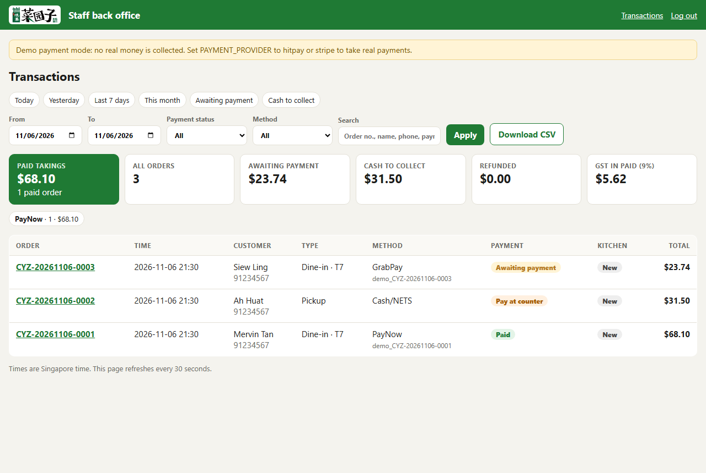
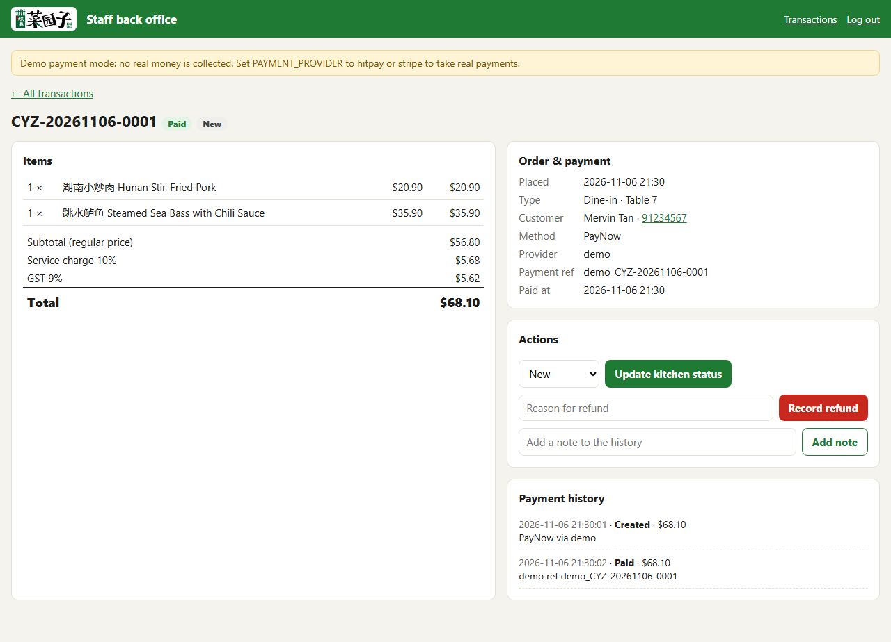

# 菜园子 Ordering Backend & Staff Back Office

The server behind the online ordering page. It:

- **saves every order and payment** in a database (SQLite file `orders.db`)
- **recalculates every price on the server** – a customer can't change prices in their browser
- **only accepts orders in ordering hours** (11:30am–2:30pm, 5:30pm–9:30pm, Singapore time)
- **confirms payments with the payment provider** (HitPay or Stripe) – an order is only marked *Paid* when the provider says so and the amount matches
- **tells the restaurant about new orders** by Telegram and/or e-mail
- gives staff a **back office at `/staff`** to check transactions



## Staff back office (`/staff`)

| Feature | What it does |
|---|---|
| **Transactions list** | Every order with time, customer, type, payment method, payment reference, payment status and kitchen status |
| **Daily summary** | Paid takings, number of orders, awaiting payment, cash to collect, refunds, GST collected, and takings per payment method |
| **Filters** | Today / Yesterday / Last 7 days / This month, any date range, payment status, payment method |
| **Search** | By order number, customer name, phone, or the provider's payment reference |
| **Order detail** | Items, totals, customer details, and the full **payment history** (created → paid → refunded, with time stamps) |
| **Actions** | Update kitchen status (new → preparing → ready → completed / cancelled), **mark cash/NETS received**, **record a refund**, add notes |
| **CSV export** | Download the filtered transactions for Excel or the accountant |
| **Phone friendly** | Works on a phone or tablet at the counter |
| **Security** | Password login, locked for 10 minutes after 5 wrong tries, logs out after 12 hours |



Payment status meanings:

| Status | Meaning |
|---|---|
| **Paid** | The provider confirmed the payment (or staff marked cash received) |
| **Awaiting payment** | The customer opened the payment page but hasn't finished paying |
| **Pay at counter** | Cash/NETS order – collect payment, then press *Mark cash/NETS received* |
| **Failed** | The payment was declined or expired |
| **Refunded** | Staff recorded a refund. **Also issue the refund in the HitPay/Stripe dashboard** – this page only records it |

## Run it on your computer

Needs Python 3.10 or newer.

```bash
cd backend
pip install -r requirements.txt
copy .env.example .env        # on Mac/Linux: cp .env.example .env
```

Open `.env` and set at least `SECRET_KEY` and `STAFF_PASSWORD`, then:

```bash
python app.py
```

- Customer ordering page: http://localhost:5050
- Staff back office: http://localhost:5050/staff

By default it runs in **demo payment mode**: no real money moves and a test page lets you "pay" (see `docs/demo-payment.png`).

Run the tests with `python -m pytest`.

## Connecting real payments

1. The restaurant opens a **HitPay** (recommended) or **Stripe** account with its UEN and business bank account.
2. Put the **sandbox / test** keys in `.env` (`PAYMENT_PROVIDER=hitpay`, `HITPAY_API_KEY`, `HITPAY_SALT`, `HITPAY_SANDBOX=1` – or the `STRIPE_…` keys).
3. In the provider dashboard, set the webhook URL to `https://<your address>/webhooks/hitpay` (or `/webhooks/stripe`).
4. Place test orders, check they show as **Paid** in `/staff`, then switch to the live keys (`HITPAY_SANDBOX=0`).

The HitPay and Stripe connections follow their public API docs but have **not yet been run against a real sandbox account** – step 4 is required before going live.

Never put real keys in GitHub or send them by chat or e-mail. They only go in `.env` on the server.

## New-order notifications

Paid orders and cash orders are sent to the restaurant. Fill in either or both in `.env`:

- **Telegram**: create a bot with @BotFather → `TELEGRAM_BOT_TOKEN`; add it to the staff group → `TELEGRAM_CHAT_ID`
- **E-mail**: `SMTP_HOST`, `SMTP_USER`, `SMTP_PASSWORD`, `ORDER_EMAIL_TO`

## Putting it online

This needs a host that runs Python (GitHub Pages can't). Good simple options: **Render**, **Railway**, **PythonAnywhere**, or a small VPS. Use HTTPS, set the `.env` values as the host's environment variables, keep `orders.db` on persistent storage, and back it up.

## Files

| File | Purpose |
|---|---|
| `app.py` | Web server: customer API, payment webhooks, staff pages |
| `orders.py` | Menu, ordering hours, price and GST calculation, input checks |
| `payments.py` | Demo, HitPay and Stripe payment connections |
| `notify.py` | Telegram / e-mail order messages |
| `store.py` | Database tables and queries |
| `menu.json` | The menu and prices – edit here to change prices |
| `static/` | The customer ordering page and photos |
| `templates/` | Staff pages, order status page, demo payment page |
| `tests/` | Automated tests |
